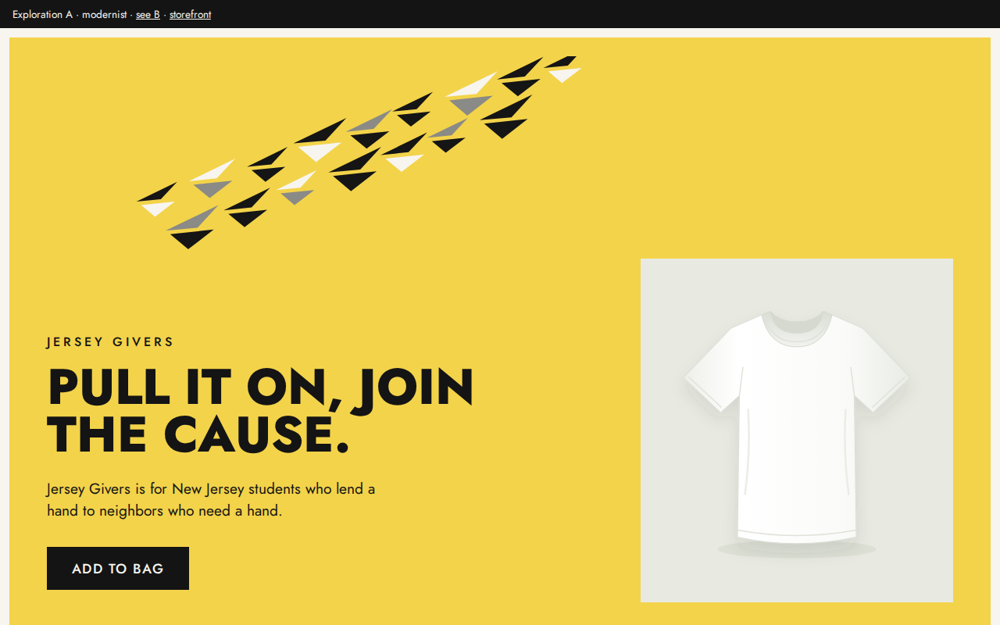
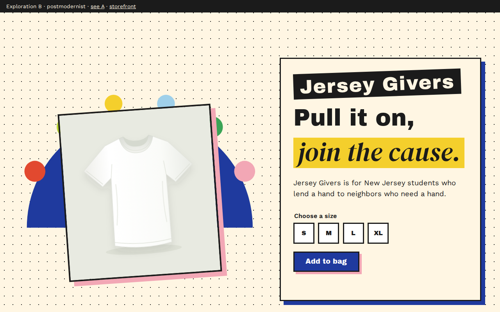
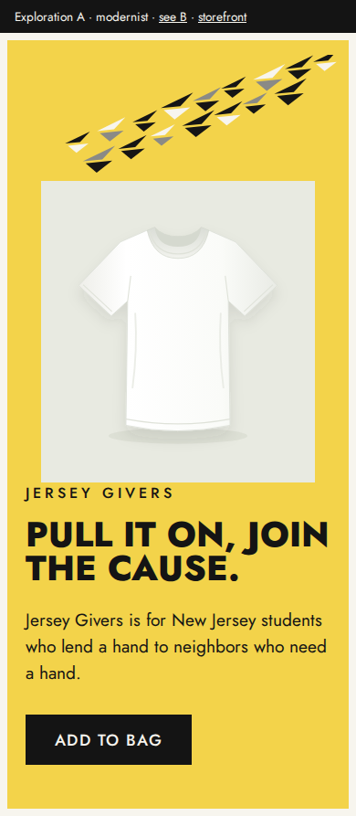
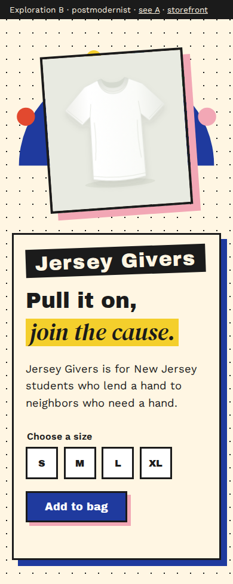

# BRAND-001 hero comparison

Both previews use the same white T-shirt image, headline ("Pull it on, join the cause."), supporting line and action ("Add to bag"). Only the design changes. A shows the headline in capitals through CSS; the source text is identical.

Live previews (with `npm run dev` running): [A, modernist](../../public/explorations/modernist.html) at `/explorations/modernist.html` and [B, postmodernist](../../public/explorations/postmodernist.html) at `/explorations/postmodernist.html`. The action links to the working size selector on the storefront.

Screenshots were taken from the current code in Chromium. At both widths, the fonts and shirt image loaded, the copy matched, and there was no horizontal scroll.

| Width          | A — modernist                       | B — postmodernist                       |
| -------------- | ----------------------------------- | --------------------------------------- |
| Desktop 1280px |  |  |
| Phone 390px    |      |      |

## A — modernist

**Reference:** Edward McKnight Kauffer, _Soaring to Success! Daily Herald — the Early Bird_, colour lithograph poster, 1918–19. V&A, [O85159](https://collections.vam.ac.uk/item/O85159/). Image viewed via the V&A collections image service.

- **Observed:** one flat yellow field, a geometric flock moving diagonally as a group, lots of empty space, and small stacked type at the bottom left with the name in heavy capitals.
- **Choices:** an original flock of angular birds rising to the right (moving together = joining), one flat yellow ground with a paper-white frame, a strict two-column grid, and a single black button as the only strong action.
- **Intended effect:** feels organized and purposeful, like "a crew that shows up", which supports the belonging goal.
- **Risk:** can feel formal or institutional, and the uppercase headline is louder than the "not showing off" concern may want.

## B — postmodernist

**Reference:** Martine Bedin, _Super_ lamp (prototype), designed for Memphis, made by Fausto Celatti, Milan, 1981. Painted steel with lighting components. V&A, [O1177310](https://collections.vam.ac.uk/item/O1177310/). Image viewed via the V&A collections image service.

- **Observed:** a deep-blue half-circle body on toy wheels, with six sockets in six different colours. A household lamp quoting a children's toy.
- **Choices:** the shirt sits on a blue half-circle "base" ringed by six differently coloured dots (many different people, one shared cause). Mixed type: a heavy grotesque, then an italic serif on a yellow highlight. A dotted background, a tilted card and hard offset shadows.
- **Intended effect:** feels friendly, homemade and open to everyone, which suits the Everyperson character and a crowd of different volunteers.
- **Risk:** can read as playful or childish rather than impactful, and the many colours may compete with the shirt.

## Learner choice and adjustments

The learner chose **B** and asked for two changes: a much larger "Jersey Givers" name, and the shirt fading in after the page loads. Both were applied to B. In a second round, the learner asked for the name to be larger still and for size choices; B now has S/M/L/XL buttons with a preview-only message (no size → asks for one; a size → confirms). The fade is skipped when the visitor's device asks for reduced motion. The B screenshots above show the adjusted version.
